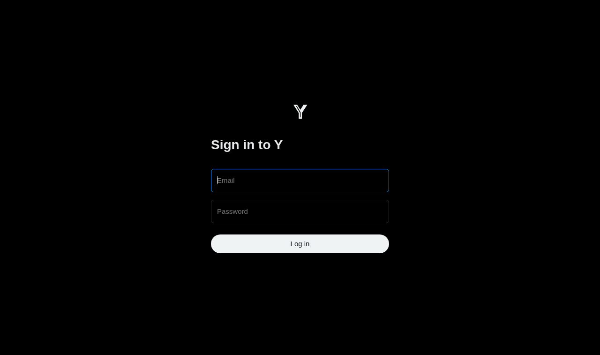
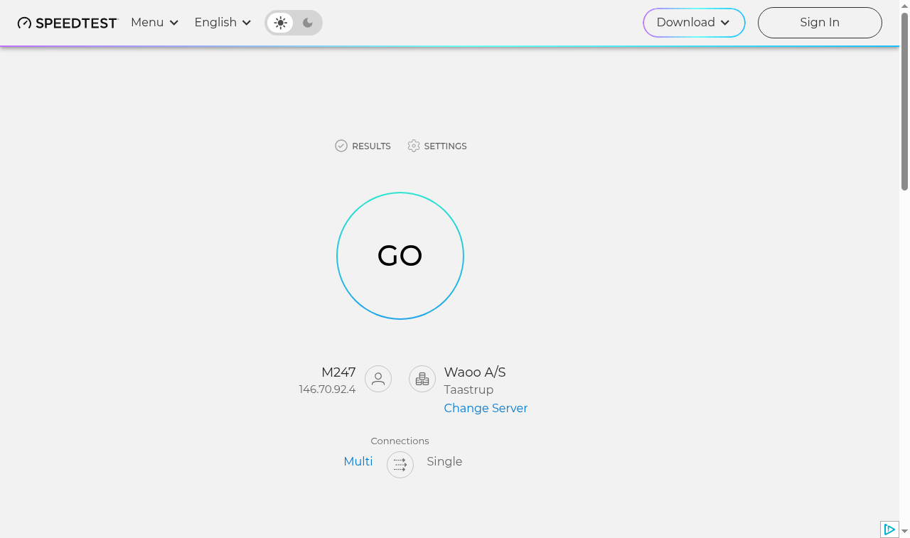
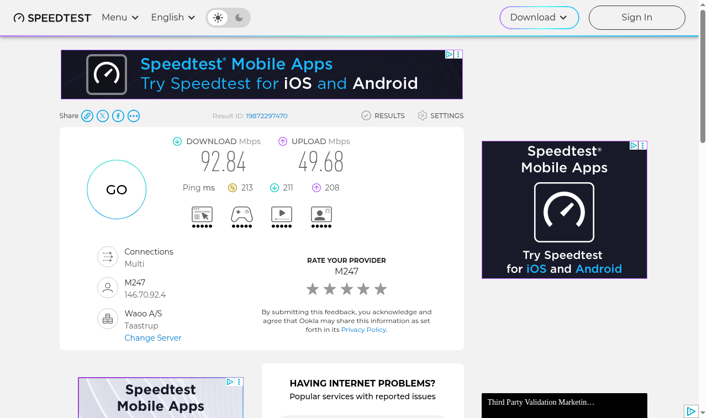

<!-- README from framework/templates/README-template.md -->

# 🚀 051-speed-isp

A Python bot (Day 51 of Udemy's *100 Days of Code*) that measures your internet speed on speedtest.net with Selenium and posts a complaint on X (or on the practice service "Y") when the speed is below what your provider promises.

## 📚 Table of Contents

- [Overview](#-overview)
- [Requirements](#-requirements)
- [Setup](#-setup)
- [Run](#-run)
- [Tests](#-tests)
- [License](#-license)
- [Links](#-links)
- [Appendix: Project documents](#-appendix-project-documents)

## 🧭 Overview

The assignment has four steps; each is a milestone of this repository:

| Lecture step | What it builds |
| --- | --- |
| 1. Set up an account and constants | Promised speeds and credentials in `src/speed_isp/constants.py` |
| 2. Create a class | `InternetSpeedTwitterBot` with `get_internet_speed()` and `tweet_at_provider()` |
| 3. Get internet speeds | Selenium reads download and upload speed from speedtest.net |
| 4. Tweet at the provider | Selenium logs in to X (or Y) and posts the complaint |

Folders:

- `src/speed_isp/` - the code, in the layers `domain`, `application`, `infrastructure`, `presentation`; constants are in `constants.py`.
- `tests/` - pytest tests (`unit`, `integration`, `e2e`); the unit tests need no browser and no network.
- `docs/` - project documents (Business Case, plan, milestones, reviews) and the wiki in English, Danish and Bahasa Malaysia (`docs/wiki/`).

## 📋 Requirements

- Python 3.13 or newer.
- Google Chrome or Chromium (Selenium Manager downloads the matching driver).
- One runtime dependency: [Selenium](https://pypi.org/project/selenium/). `pytest` is only needed to run the tests.
- Optional: [Doxygen](https://www.doxygen.nl/) to build the API documentation.

## 🛠️ Setup

Create a local virtual environment named `.venv` in the project folder, activate it, upgrade pip and install the project.

Windows (PowerShell):

```powershell
python -m venv .venv
.venv\Scripts\Activate.ps1
python -m pip install --upgrade pip
python -m pip install -e ".[test]"
```

Linux and macOS:

```bash
python3 -m venv .venv
source .venv/bin/activate
python -m pip install --upgrade pip
python -m pip install -e ".[test]"
```

Leave the environment with `deactivate`. The folder `.venv/` is ignored by git.

Set your promised speeds in `src/speed_isp/constants.py` (`PROMISED_DOWN`, `PROMISED_UP`). Credentials are read from environment variables and are never stored in the code; never commit them.

```bash
export Y_EMAIL="you@example.com"      # PowerShell: $env:Y_EMAIL = "you@example.com"
export Y_PASSWORD="your-password"     # PowerShell: $env:Y_PASSWORD = "your-password"
```

For X use `TWITTER_EMAIL`, `TWITTER_PASSWORD` and `SPEED_ISP_SERVICE=X`. Set `SPEED_ISP_PROVIDER` (for example `@Comcast`) to mention your provider.

## ▶️ Run

```bash
python -m speed_isp
```

The bot measures the speed (this takes up to three minutes), prints it, and posts a complaint if it is below the promised speed.

## 🧪 Tests

```bash
python -m pytest
```

Build the API documentation with `doxygen Doxyfile` (output in `docs/doxygen/`).

## 📸 Lecture steps in pictures

The wiki (English, Danish and Bahasa Malaysia, in `docs/wiki/`) explains each step and what it taught. These are the screenshots, taken from headless runs in a Docker container:

| Step | Screenshot |
| --- | --- |
| 1. Account and constants: the login page of the practice service Y |  |
| 2. Create a class: the bot has opened speedtest.net |  |
| 3. Get internet speeds: the finished speed test |  |
| 4. Tweet at the provider | Not yet taken: it needs your own Y account. Run the bot with `Y_EMAIL`, `Y_PASSWORD` and `SPEED_ISP_SCREENSHOT_DIR=docs/images` set and it writes `step-4-tweet-posted.png`. |

## Live run in Docker

```bash
docker build -t speed-isp -f docker/Dockerfile .
docker run --rm -e SPEED_ISP_SCREENSHOT_DIR=/shots -v "$PWD/docs/images:/shots" speed-isp
```

The image has a headless Chromium, so the run never opens a window on your desktop.

## 📄 License

See [LICENSE](./LICENSE).

## 🔗 Links

- [Repository][repository]
- [Documentation][documentation]
- [Issue tracker][issues]

## 📎 Appendix: Project documents

| Document | What it tells you |
| --- | --- |
| [AGENTS.md][agents] | The rules AI agents follow in this repository |
| [Business Case][BC-001] | Why the project exists, its scope and success criteria |
| [Stakeholder Analysis][SA-001] | Who is involved; the stakeholder IDs used for owners and reviewers |
| [Project Plan][PP-001] | The gateways and their schedule |
| [Milestones][milestones] | One document per gateway: Go/No-Go criteria and tasks |
| [Artifact registry][registry] | Where each artifact type lives, the next version, the PO language and domain |
| [Framework README][framework-readme] | The framework this project uses |
| [Framework changelog][framework-changelog] | What changed in each framework release |

---

[repository]: https://git.tirsystem.com/Tirsvad-Udemy-100-days-of-code/051-speed-isp
[documentation]: https://git.tirsystem.com/Tirsvad-Udemy-100-days-of-code/051-speed-isp/wiki
[issues]: https://git.tirsystem.com/Tirsvad-Udemy-100-days-of-code/051-speed-isp/issues
[agents]: ./AGENTS.md
[BC-001]: ./docs/business-case.md
[SA-001]: ./docs/stakeholder-analysis.md
[PP-001]: ./docs/project-plan.md
[milestones]: ./docs/milestones/
[registry]: ./docs/artifact-registry.md
[framework-readme]: ./framework/README.md
[framework-changelog]: ./framework/CHANGELOG.md
