# Project Plan

## Metadata
| Key | Value |
| --- | --- |
| ID | PP-001 |
| CrossReference | [BC-001], [SA-001], [MIL-001], [MIL-002], [MIL-003], [MIL-004] |
| Language | en |
| Domain | it |

## Version History
| Date | Status | Author | Reviewer | Change | Commit |
| --- | --- | --- | --- | --- | --- |
| 2026-11-04 | Proposed | Jens Tirsvad Nielsen | S01 | Initial version | pending |

---

## Purpose

Schedule the four phases that deliver the Day 51 speed-complaint bot ([BC-001]) as one pull request per milestone, within the constraints of Python 3.13+, a single runtime dependency and a three-language wiki.

## Planning Assumptions

- Start date 2026-11-04; each phase is a short working session.
- Each phase is delivered by a branch and a pull request; the branch name keeps track of the step (`mil-001-project-baseline`, and so on).
- Communication follows [SA-001]: S01 reviews at plan acceptance and at the end of the run.
- In autonomous mode the AI is S01's stand-in reviewer; every such review is recorded as `Mode: autonomous, not independent`.

## Gateway Schedule

| Gateway | Document | Window | Decision date | Owner | Stories | Main deliverable | Milestone |
| --- | --- | --- | --- | --- | --- | --- | --- |
| MIL-001 | [MIL-001] | 2026-11-04 | 2026-11-04 | S01 | none | Project baseline: repository metadata, `pyproject.toml`, `.gitignore`, `constants.py`, `Doxyfile`, README | |
| MIL-002 | [MIL-002] | 2026-11-04 to 2026-11-05 | 2026-11-05 | S01 | none | Lecture steps 2 and 3: bot class and live speed measurement | |
| MIL-003 | [MIL-003] | 2026-11-05 | 2026-11-05 | S01 | none | Lecture steps 1 and 4: login and tweet at the provider | |
| MIL-004 | [MIL-004] | 2026-11-05 to 2026-11-06 | 2026-11-06 | S01 | none | README screenshots and three-language wiki | |

## Timeline diagram

```plantuml
@startgantt
Project starts 2026-11-04
[MIL-001 Project baseline] starts 2026-11-04 and lasts 1 day
[MIL-002 Speed test] starts 2026-11-05 and lasts 1 day
[MIL-003 Tweet bot] starts 2026-11-05 and lasts 1 day
[MIL-004 Wiki and screenshots] starts 2026-11-06 and lasts 1 day
[MIL-002 Speed test] starts at [MIL-001 Project baseline]'s end
[MIL-003 Tweet bot] starts at [MIL-002 Speed test]'s end
[MIL-004 Wiki and screenshots] starts at [MIL-003 Tweet bot]'s end
@endgantt
```

## Scope Coverage

| Business Case scope item | Delivered by |
| --- | --- |
| Constants, `pyproject.toml`, `.gitignore`, `Doxyfile`, README, repository description and topics | MIL-001 |
| Bot class, speed measurement | MIL-002 |
| Login and tweet on Y and X | MIL-003 |
| Unit tests with pytest | MIL-002, MIL-003 |
| Wiki in en, da, ms with a screenshot per step | MIL-004 |

## Dependencies

MIL-001 → MIL-002 → MIL-003 → MIL-004. A No-Go on a gate stops the later gates; their dates move by the length of the rework.

## Plan Risks

| Risk | Mitigation |
| --- | --- |
| Selectors of speedtest.net or Y change before the live run | Selectors are constants; re-verify during MIL-002 and MIL-003 |
| Y or X credentials are not available for the live run | See Open Issues; screenshots of those steps wait for S01 |
| Gitea API token lacks a scope for repository topics | Stop and report; S01 sets topics by hand |

## Open Issues

- Y (or X) credentials: the project reads `Y_EMAIL` and `Y_PASSWORD` from the environment. The AI does not create accounts or type passwords into pages. S01 supplies them in the environment, or takes the screenshots for the login and tweet steps.
- "Python greater than 3.13" is read as 3.13 or newer (`requires-python = ">=3.13"`).
- Live measurement and tweet runs use a headless browser in a Docker container, never the host desktop.

---

[BC-001]: business-case.md
[SA-001]: stakeholder-analysis.md
[MIL-001]: milestones/mil-001-project-baseline.md
[MIL-002]: milestones/mil-002-speed-test.md
[MIL-003]: milestones/mil-003-tweet-bot.md
[MIL-004]: milestones/mil-004-wiki-screenshots.md
