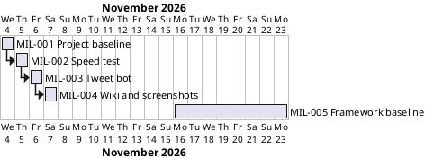

# Project Plan

## Metadata
| Key | Value |
| --- | --- |
| ID | PP-001 |
| CrossReference | [BC-001], [SA-001], [MIL-001], [MIL-002], [MIL-003], [MIL-004], [MIL-005] |
| Language | en |
| Domain | education |

## Version History
| Date | Status | Author | Reviewer | Change | Commit |
| --- | --- | --- | --- | --- | --- |
| 2026-11-05 | Deprecated | Jens Tirsvad Nielsen | S01 | Open Issues: live run on Y done | [7e6cbe8] |
| 2026-11-05 | Deprecated | Jens Tirsvad Nielsen | S01 | Open Issues: X flow closed, no X account | [9c98c93] |
| 2026-11-16 | Accepted | Jens Tirsvad Nielsen | AI as stand-in for S01 | Added the baseline gateway MIL-005 with its schedule row, scope coverage, dependency, risk and Gantt entries; recorded the move of the end date, the domain and the live-site rule in the Planning Assumptions and Open Issues; set the domain to education; reviewed in autonomous mode, not independent | [5d274b7] |

---

## Purpose

Schedule the four phases (and, since the baseline gateway, a fifth) that deliver the Day 51 speed-complaint bot ([BC-001]) as one pull request per milestone, within the constraints of Python 3.13+, a single runtime dependency and a three-language wiki. The fifth gateway, the framework baseline ([MIL-005]), brings the finished project to the common baseline of the framework.

## Planning Assumptions

- Start date 2026-11-04; each phase is a short working session.
- Each phase is delivered by a branch and a pull request; the branch name keeps track of the step (`mil-001-project-baseline`, and so on).
- Communication follows [SA-001]: S01 reviews at plan acceptance and at the end of the run.
- In autonomous mode the AI is S01's stand-in reviewer; every such review is recorded as `Mode: autonomous, not independent`.
- The baseline gateway MIL-005 starts 2026-11-16 and ends 2026-11-23, one week (source: [BC-001], Constraints). It brings the finished project to the baseline of the framework, a decision of S01. The decision dates of the earlier gateways stay as they were, so the end date of the plan moves from 2026-11-06 to 2026-11-23.
- For MIL-005 S01 has authorised the assistant to commit, push, open the pull request and merge it, and the review is done by an AI stand-in for S01 (source: [BC-001], Constraints and Risks).

## Gateway Schedule

| Gateway | Document | Window | Decision date | Owner | Stories | Main deliverable | Milestone |
| --- | --- | --- | --- | --- | --- | --- | --- |
| MIL-001 | [MIL-001] | 2026-11-04 | 2026-11-04 | S01 | none | Project baseline: repository metadata, `pyproject.toml`, `.gitignore`, `constants.py`, `Doxyfile`, README | [330](https://git.tirsystem.com/Tirsvad-Udemy-100-days-of-code/051-speed-isp/milestone/330) |
| MIL-002 | [MIL-002] | 2026-11-04 to 2026-11-05 | 2026-11-05 | S01 | none | Lecture steps 2 and 3: bot class and live speed measurement | [331](https://git.tirsystem.com/Tirsvad-Udemy-100-days-of-code/051-speed-isp/milestone/331) |
| MIL-003 | [MIL-003] | 2026-11-05 | 2026-11-05 | S01 | none | Lecture steps 1 and 4: login and tweet at the provider | [332](https://git.tirsystem.com/Tirsvad-Udemy-100-days-of-code/051-speed-isp/milestone/332) |
| MIL-004 | [MIL-004] | 2026-11-05 to 2026-11-06 | 2026-11-06 | S01 | none | README screenshots and three-language wiki | [333](https://git.tirsystem.com/Tirsvad-Udemy-100-days-of-code/051-speed-isp/milestone/333) |
| MIL-005 | [MIL-005] | 2026-11-16 to 2026-11-23 | 2026-11-23 | S01 | none (technical tasks) | Branch `mil-005-framework-baseline` merged: the adopted framework release, the README, project URL metadata, `.editorconfig`, `.env.example` and review records | [Milestone 570] |

## Timeline diagram

## Scope Coverage

| Business Case scope item | Delivered by |
| --- | --- |
| Constants, `pyproject.toml`, `.gitignore`, `Doxyfile`, README, repository description and topics | MIL-001 |
| Bot class, speed measurement | MIL-002 |
| Login and tweet on Y and X | MIL-003 |
| Unit tests with pytest | MIL-002, MIL-003 |
| Wiki in en, da, ms with a screenshot per step | MIL-004 |
| The baseline: framework release, README, project URL metadata, editor settings, environment template, review records (objective 6) | MIL-005 |

## Dependencies

MIL-001 → MIL-002 → MIL-003 → MIL-004 → MIL-005. A No-Go on a gate stops the later gates; their dates move by the length of the rework.

## Plan Risks

| Risk | Mitigation |
| --- | --- |
| Selectors of speedtest.net or Y change before the live run | Selectors are constants; re-verify during MIL-002 and MIL-003 |
| Y or X credentials are not available for the live run | See Open Issues; screenshots of those steps wait for S01 |
| Gitea API token lacks a scope for repository topics | Stop and report; S01 sets topics by hand |
| A continuous integration (CI) check fails on the pull request of MIL-005 | The merge is delayed past 2026-11-23 | The failure is fixed on the same branch and the checks run again; after three failed rounds on one cause the work stops and S01 decides (trace: success criterion 7 of [BC-001]) |

## Open Issues

- Y (or X) credentials: the project reads `Y_EMAIL` and `Y_PASSWORD` from the environment. The AI does not create accounts or type passwords into pages. S01 supplies them in the environment, or takes the screenshots for the login and tweet steps.
- "Python greater than 3.13" is read as 3.13 or newer (`requires-python = ">=3.13"`).
- The live tweet run on Y and the step 4 screenshot are done (2026-11-05; MIL-003 task 5, issue 15). The X flow is closed without a live run: S01 has no X account and closed this item in chat (2026-11-05). The X selectors stay best effort and unverified; the practice service Y is the supported target.
- Live measurement and tweet runs use a headless browser in a Docker container, never the host desktop.
- Domain: since [MIL-005] the plan, the Business Case and the baseline milestone have the domain `education`. The other documents (Stakeholder Analysis, milestones MIL-001 to MIL-004, the ADR and the review records RC-001 to RC-011) keep the domain `it` they were accepted with; they are not changed by the baseline, and a change of their domain would need a new review of each. The project has no Traceability Matrix; the Traceability tables of the milestones map the objectives.
- Live services: running the bot opens speedtest.net and the practice service Y (or X) in Chrome and signs in with an account of the reader; automating a third-party service may violate its terms of use, so the reader checks them first. MIL-005 opens no web page, starts no browser, runs no speed test, signs in to no site, posts nothing and runs no container; the tests use fakes.

---

[BC-001]: business-case.md
[SA-001]: stakeholder-analysis.md
[MIL-001]: milestones/mil-001-project-baseline.md
[MIL-002]: milestones/mil-002-speed-test.md
[MIL-003]: milestones/mil-003-tweet-bot.md
[MIL-004]: milestones/mil-004-wiki-screenshots.md
[2b623e7]: https://git.tirsystem.com/Tirsvad-Udemy-100-days-of-code/051-speed-isp/commit/2b623e74fbf13b90599da7d0c31a9ec38b19ef6e
[7e6cbe8]: https://git.tirsystem.com/Tirsvad-Udemy-100-days-of-code/051-speed-isp/commit/7e6cbe8cfb9770096a089ddbae025e63f7468d31
[9c98c93]: https://git.tirsystem.com/Tirsvad-Udemy-100-days-of-code/051-speed-isp/commit/9c98c93f975d7b6b36ec2d7a2862db40fa794aef
[MIL-005]: ./milestones/mil-005-framework-baseline.md
[Milestone 570]: https://git.tirsystem.com/Tirsvad-Udemy-100-days-of-code/051-speed-isp/milestone/570
[5d274b7]: https://git.tirsystem.com/Tirsvad-Udemy-100-days-of-code/051-speed-isp/commit/5d274b7c566f9670b6f792c7832440ea30e0d076
